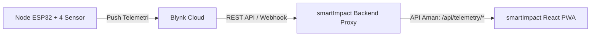

# smartImpact — IoT Water Quality Monitoring PWA

Aplikasi Web Progresif (PWA) modern untuk pemantauan kualitas air (*Water Quality Monitoring*) secara *real-time* berbasis IoT (ESP32 dan Blynk Cloud). Dirancang dengan fokus pada kejelasan data, keterbacaan, keandalan, dan keamanan kredensial.

---

## 1. Teknologi yang Digunakan

- **Framework**: React 19 (JavaScript)
- **Bundler & Tooling**: Vite 8
- **Routing**: React Router v7 (`react-router-dom`)
- **Visualisasi Grafik**: Recharts
- **Icon Set**: Lucide React
- **Linter**: Oxlint (Oxc)
- **Styling**: Vanilla CSS dengan Design Token sistematis (`#123B45`, `#0F766E`, `#E0F2F1`, `#F5F8FA`)

---

## 2. Persyaratan Lingkungan

- **Node.js**: Versi `>= 18.0.0` (Direkomendasikan Node.js LTS)
- **NPM**: Versi `>= 9.0.0`

---

## 3. Instalasi dan Menjalankan Proyek

### 3.1 Instalasi Dependensi
```bash
npm install
```

### 3.2 Menjalankan Server Pengembangan (Dev)
```bash
npm run dev
```
Aplikasi akan tersedia secara default di `http://localhost:5173`.

### 3.3 Menjalankan Linter
```bash
npm run lint
```

### 3.4 Menjalankan Unit & Validation Test
```bash
npm test
```

### 3.5 Build Produksi
```bash
npm run build
```
Hasil kompilasi produksi siap deploy akan berada di folder `dist/`.

---

## 4. Konfigurasi Environment (`.env`)

Salin file `.env.example` menjadi `.env.local` jika diperlukan penyesuaian:

```bash
cp .env.example .env.local
```

### Variabel yang Didukung:

| Variabel | Default | Keterangan |
| :--- | :--- | :--- |
| `VITE_API_BASE_URL` | `/api` | Base path URL menuju proxy backend aman smartImpact. |
| `VITE_DEMO_MODE` | `true` | `true` untuk mode simulasi lokal, `false` untuk koneksi live backend. |
| `VITE_API_TIMEOUT_MS` | `8000` | Batas waktu timeout permintaan HTTP (milidetik). |

> **PERINGATAN KEAMANAN KRITIS**:
> **JANGAN PERNAH** menaruh *Blynk Auth Token*, API Key privat, atau password di file `.env` frontend atau variabel `VITE_*`. Semua variabel `VITE_*` akan dikompilasi ke dalam bundle client JavaScript dan dapat dibaca oleh publik di browser. Kredensial Blynk **wajib berada di server-side backend**.

---

## 5. Arsitektur Komunikasi Data



1. **ESP32**: Membaca sensor fisik (Suhu, pH, Turbidity, TDS) dan mengirimkannya ke Blynk Cloud.
2. **Backend Proxy**: Menyimpan Blynk Auth Token secara aman di environment server, mengambil data telemetri, menyimpan riwayat waktu (*time-series*), dan mengekspos endpoint API yang aman untuk frontend.
3. **Frontend React PWA**: Meminta data melalui `apiClient` tanpa pernah mengetahui kredensial privat Blynk.

---

## 6. Spesifikasi Kontrak API & Model Data

### 6.1 Telemetri Terbaru: `GET /api/telemetry/latest`

#### Contoh Respons Sukses dari Backend:
```json
{
  "deviceId": "ESP32-001",
  "deviceName": "ESP32 Water Node",
  "location": "Sungai Ciliwung",
  "receivedAt": "2026-10-25T04:00:00.000Z",
  "sensors": {
    "temperature": { "value": 25.4, "unit": "°C" },
    "ph": { "value": 7.2, "unit": "" },
    "turbidity": { "value": 4.8, "unit": "NTU" },
    "tds": { "value": 320, "unit": "ppm" }
  }
}
```

#### Sensor yang Didukung & Divalidasi:
1. **Suhu Air (`temperature`)**: Satuan `°C`, 1 angka di belakang koma.
2. **Derajat Keasaman (`ph`)**: Rentang teknis 0–14, tanpa satuan teknis (`pH`), 1 angka di belakang koma.
3. **Kekeruhan (`turbidity`)**: Satuan `NTU`, 1 angka di belakang koma.
4. **Padatan Terlarut (`tds`)**: Satuan `ppm`, angka bulat.

---

## 7. Ketahanan & Penanganan Masalah (*Fault Tolerance*)

1. **Timeout & Request Cancellation**: Setiap request dibatasi timeout (default 8 detik) menggunakan `AbortController`. Request otomatis dibatalkan saat komponen unmount untuk menghindari kebocoran memori.
2. **Pembedaan Status Offline**:
   - **Browser Offline**: Terdeteksi via `navigator.onLine` / event `offline`. Aplikasi tetap menampilkan data cache terakhir dengan pemberitahuan jelas.
   - **ESP32 Offline**: Dihitung dari timestamp bukti data (`receivedAt` > 15 menit).
3. **Penyimpanan Data Saat Refresh Gagal (*Stale Retention*)**: Jika penyegaran berkala gagal, data valid sebelumnya tidak dihapus, melainkan ditandai sebagai *stale* disertai peringatan visual.
4. **Kegagalan Parsial Sensor (*Partial Sensor Failure*)**: Jika salah satu sensor terlepas atau mengirim `NaN`/`null`, sensor lain tetap ditampilkan secara normal dan sensor yang bermasalah ditandai secara eksplisit tanpa merusak seluruh dashboard.
5. **Pencegahan Polling Tumpang Tindih**: Ref `isFetchingRef` memastikan tidak ada request ganda/bertabrakan selama request sebelumnya masih berlangsung.

---

## 8. Mode Demo vs Mode Live

- **Mode Demo**: Menggunakan adapter lokal deterministic (`mockAdapter.js`). Pengguna dapat menguji 6 skenario telemetri (Normal, Stale, Offline, Partial Failure, Batas Belum Diatur, Error, dan Kosong).
- **Mode Live API**: Menggunakan adapter jaringan (`liveApiAdapter.js`) yang memanggil backend smartImpact. Jika backend belum aktif, UI menyajikan pesan error yang jujur dan informatif tanpa crash.
- Tombol peralihan mode tersedia langsung pada banner di halaman **Dashboard**.

---

## 9. Blocker & Kebutuhan Sebelum Integrasi Live Penuh

Sebelum integrasi hardware fisik dan Blynk Cloud dapat difinalisasi:

1. **Penyediaan Server Backend Proxy**: Dibutuhkan service server-side (misal Node.js/Express) untuk menyimpan Blynk Auth Token secara aman.
2. **Pemetaan Virtual Pin / Datastream**: Menentukan pemetaan pin virtual Blynk (misal `V0`, `V1`, `V2`, `V3`) terhadap keempat sensor air.
3. **Kredensial & URL Blynk Server**: Mengetahui apakah menggunakan server `blynk.cloud` atau cluster regional (seperti `sgp1.blynk.cloud`).
4. **Frekuensi Pengiriman ESP32**: Mengetahui interval transmisi ESP32 ke Blynk untuk menyelaraskan interval polling di frontend.
5. **Database Riwayat Telemetri**: Menentukan solusi penyimpanan data historis (karena Blynk Free Tier membatasi histori API).

---

## 10. Progressive Web App (PWA) & Offline Behavior

smartImpact dikonfigurasi sebagai PWA penuh menggunakan `vite-plugin-pwa` (Workbox):

- **Manifest Web App**: `dist/manifest.webmanifest` dengan konfigurasi `display: "standalone"`, `theme_color: "#123B45"`, `background_color: "#F5F8FA"`, dan ikon adaptif (`pwa-192x192.png`, `pwa-512x512.png`, serta `maskable-icon-512x512.png`).
- **Service Worker (`sw.js`)**:
  - Meng-cache App Shell (`index.html`, bundle CSS/JS, icon assets, web font).
  - Menggunakan strategi `cleanupOutdatedCaches` untuk memastikan pengguna mendapatkan update UI terbaru tanpa terjebak di versi lama.
  - Mengonfigurasi endpoint `/api/*` dengan strategi `NetworkOnly` (Workbox **tidak** meng-cache token privat atau respon API sembarangan).
- **Perilaku Saat Offline**:
  - App shell tetap dapat dibuka meski jaringan internet terputus.
  - Data telemetri terakhir yang valid dipertahankan dengan penanda *stale* dan cap waktu pembaruan terakhir.
  - Pengguna diberi informasi eksplisit bahwa pembaruan sensor live ESP32 tidak dapat berlangsung tanpa koneksi internet.
- **Persyaratan Lingkungan**:
  - PWA dan Service Worker mewajibkan protokol **HTTPS** pada lingkungan produksi (pada lingkungan pengembangan lokal, browser mengizinkan konteks `localhost`).
- **Petunjuk Instalasi**:
  - Petunjuk manual untuk Chrome/Edge Desktop, Android, dan iOS Safari tersedia pada menu **Pengaturan**.
